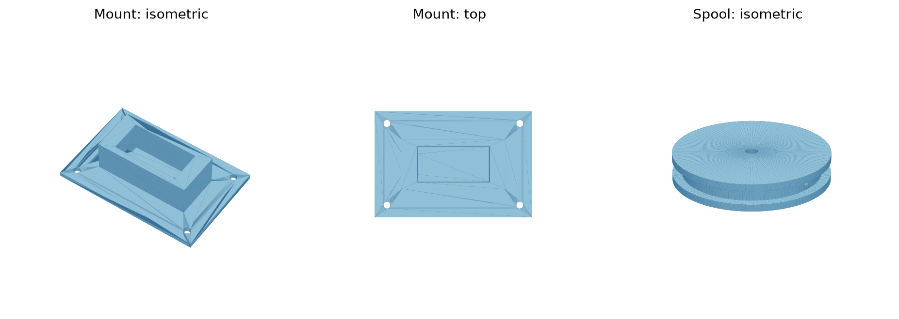

# Smart door-chain release (prototype)

This retrofit pulls the sliding pin out of an **existing metal door-chain latch** from the inside. The metal chain and its original mounting screws retain the door load. The printed parts are a servo mount and a cord spool; they are **not** a replacement lock. Nothing mounts to the outside of the door.

It can **release remotely** through ESPHome and Home Assistant. To set the chain, reset the spool and slide the chain pin in by hand from inside. A conventional chain cannot engage itself after you leave, so this design does not lock remotely. Keep your existing primary door lock in use. This prototype has not been physically fitted or security tested.

```text
Frame anchor -- metal chain -- sliding pin [receiver slot on door]
                                  ^
                                  | cord, through screw eye
                            servo spool on door
```



## Parts

- A metal door-chain latch like the one in the reference photo, installed on the inside face of the door and frame
- TowerPro MG996R servo with its supplied plastic horn and screws ([manufacturer dimensions and electrical ratings](https://towerpro.com.tw/product/mg996r/))
- ESP32 DevKit board and a regulated **5 V, at least 2 A** supply for the servo (the maker lists 1.4 A stall current); power the ESP32 separately by USB and join the grounds
- 0.8–1 mm braided cord, a small metal screw eye, and a hand-removable fishing snap to clip the cord to a chain link
- Two M2 × 16 mm bolts and nuts to secure the spool to the supplied horn, plus four suitable screws for the printed mount; use the metal chain latch's own screws for its plates

## Print files

| Part | STL | STEP | Size (mm) |
| --- | --- | --- | --- |
| Servo mount | [servo_mount.stl](parts/servo_mount.stl) | [servo_mount.step](parts/servo_mount.step) | 92 × 62 × 30.8 |
| Cord spool | [cord_spool.stl](parts/cord_spool.stl) | [cord_spool.step](parts/cord_spool.step) | 50 diameter × 12 |

Print in PETG, flat side on the bed, with 0.2 mm layers, four walls, and 30% infill. No supports are needed. The mount sleeve has a 41.7 × 20.7 mm opening for the maker's 40.7 × 19.7 mm servo body. Dry-fit your actual servo; clones vary. The mounting flange rests on the sleeve. Mark and pilot-drill its two screw holes through the printed end walls after fitting. The spool intentionally has no horn pattern: hold the supplied horn against its flat underside, mark and drill two 2 mm through-holes, then bolt the horn and spool together. The center hole gives access to the horn's servo screw; use that screw too.

The spool's 22 mm cord radius winds about 61 mm over the manufacturer's stated 159° travel. Measure your chain slot; the actual usable stroke depends on servo calibration and cord routing.

## Wiring and setup

| Servo lead | Connection |
| --- | --- |
| Red | External regulated 5 V |
| Brown/black | External supply ground and ESP32 GND |
| Orange/yellow | ESP32 GPIO18 |

Flash [chain_release.yaml](chain_release.yaml) with [ESPHome](https://esphome.io/). Put Wi-Fi credentials and a unique 32-byte base64 ESPHome API key in a local `secrets.yaml`; that file is gitignored. The keys are `wifi_ssid`, `wifi_password`, and `api_key`. Generate the API key with `python3 -c 'import base64,secrets; print(base64.b64encode(secrets.token_bytes(32)).decode())'`. Add the ESPHome device to Home Assistant. The **Chain cord position** control is a servo command, not a sensor that verifies the chain's state. The [ESPHome servo](https://esphome.io/components/servo/) and [template number](https://esphome.io/components/number/template/) documentation explain the control values.

## Fit and calibrate

1. Mount the metal chain latch first and confirm it works by hand. Mount the servo plate nearby on the **inside**, where its spool and cord cannot hit the opening door. Use solid door/frame material, not loose trim.
2. With the cord **disconnected**, command the ESPHome control from 0 toward each end in 5% steps. Confirm which direction winds the spool and that it moves freely. The servo must not drive into a hard stop.
3. Fit the horn and spool. Run cord from the spool through the metal screw eye so its last segment pulls the chain pin **toward the release opening** of the slot. Clip the cord to a chain link or the pin's loop with the hand-removable snap. Keep it accessible from inside.
4. With the door **open**, test short movements first and increase travel until the chain pin exits. Do not let the servo over-pull after release. Close the door and repeat only after the open-door test passes.
5. To set the chain manually, move the control back to unwind cord, then insert the chain pin in the receiver. With power off, verify you can unclip the cord and operate the chain entirely by hand.

Close the door fully to take tension off the chain before commanding release. Do not use this as the only means of exit or as a security-rated lock. For access while away, connect through a securely configured Home Assistant remote connection; do not expose the ESPHome device directly to the internet.

## Rebuild the CAD

The source of truth is [cad/servo_mount.py](cad/servo_mount.py) and [cad/cord_spool.py](cad/cord_spool.py). With `build123d` installed, run each file with Python to regenerate its STEP and STL in `parts/`.
